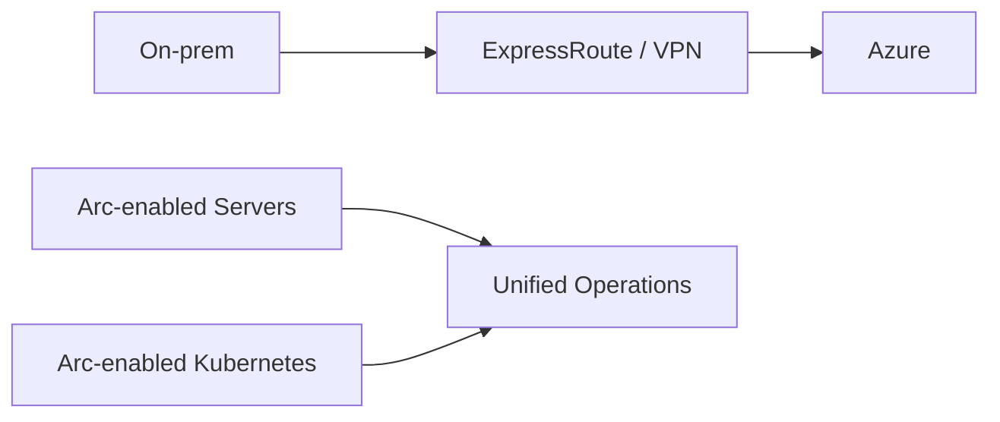

# Hybrid Connectivity and Azure Arc

This repository documents enterprise hybrid connectivity, Azure Arc enablement, and governance patterns for unified operations across cloud and on-premise estates.

